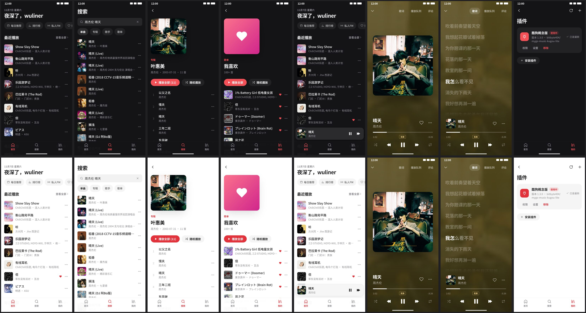

# MyGo 音乐 (mygo_mobile)



A mobile (Flutter) music player that runs **MyGo Music plugins unchanged** — the same
`plugin.json` + `index.js` packages the desktop app [egoist/mygo-music](https://github.com/egoist/mygo-music)
loads. The app has no music service of its own: every catalogue, sign-in, stream and lyric
comes from an installed plugin (e.g. [kugou-lite](https://github.com/bitbyte404/mygo-music-kugou-lite)).

Android first (package `io.github.bitbyte404.mygo_mobile`); the code is plain Flutter + dart:ffi so
iOS can follow.

## Features

- **Looks and moves like MyGo Music**, adapted to touch: MyGo's palette (light and dark, following
  the system), type scale, icons, covers, track rows, pills, the player bar, Now Playing growing out
  of the player on a spring with the artwork's colors behind it, and synced lyrics that glide to the
  line sung. No stock Material chrome. See [docs/DESIGN.md](docs/DESIGN.md).
- **Adaptive layout** by width class: phones get a tab bar (首页 / 搜索 / 我的) and a mini player that
  expands into Now Playing (tap, or drag it up; drag Now Playing down to close); tablets, foldables
  and landscape (≥ 840 dp) get the desktop layout with the plugin's navigation in a sidebar, card
  grids, the player bar, and Now Playing with cover and lyrics side by side; 600–840 dp an icon rail.
- **Edge to edge**: content and artwork draw under transparent status and navigation bars (no
  contrast scrim, display cutouts on the short edges); bar icons follow the theme and Now Playing's
  artwork; the tab bar and mini player sit above the gesture bar or the 3-button bar.
- **Plugin runtime** — each plugin runs in its own QuickJS-ng engine (`libmygojs.so`) on its own
  background isolate, with the desktop host API re-implemented in Dart: storage, settings,
  locales (`host.t`), md5 / AES / RSA, `fetch` limited to the plugin's declared network
  permission, timers, and the sign-in prompt (QR code / link).
- **Install plugins** from a GitHub repository (default-branch zip via codeload; `plugin.json` at the
  root or one folder deep) or from a local zip, with a permission review before install.
  Update checks read the repo's `plugin.json` from raw.githubusercontent.com (no GitHub API rate limit).
  Deep link `mygo-music://install-plugin?repo=owner/repo` (as the desktop app answers) opens the installer.
- **Browse** — the plugin's home (under a greeting), pages, albums, artists, playlists, "see all" pages, stations.
- **Search** — songs / albums / artists / playlists with paging and suggestions.
- **我的** — account and QR sign-in, liked songs (Play all plays every liked song, loading the
  remaining pages first), recently played (the source's list and this device's, one entry),
  playlists, saved albums, the plugin's own pages, plugins, settings.
- **Now playing** — queue, quality choice (standard … lossless/Hi-Res where the plugin offers it,
  with a 无损 badge), synced lyrics (line and word timing, tap a line to seek), comments when the
  plugin exports them.
- **Playback** — just_audio + audio_service: background play, notification and lock-screen
  controls, media buttons. Stream URLs are requested from the plugin when each track starts
  (they expire), with the headers the plugin returns.
- UI in Simplified Chinese and English (with Flutter's own localizations for both).

## Architecture

Layered `core` → `data` → `features`, with the design system in `ui` and the composition root in
`app`; plugins run behind a `PluginRuntime` platform interface (QuickJS-ng over FFI today, a web
runtime can slot in). Details, the runtime/isolate model, a diagram, and how plugins map to
features: [docs/ARCHITECTURE.md](docs/ARCHITECTURE.md).

```
lib/
  main.dart · app/ (bootstrap, services, app)
  core/      models, errors, plugin manifest, runtime interface + quickjs/ (JsEngine, PluginHost, PluginWorker)
  data/      plugins (manager, installer), library (MusicRepository, LikedStore), player, settings, navigation
  ui/        design system: theme (tokens, icons), components, layout
  features/  shell, home, browse, search, album, artist, playlist, liked, recent, stations, library,
             now_playing, lyrics, account, plugins, settings, common
  l10n/      the app's strings (zh-CN, en)
assets/js/prelude.js    JS side of the host API given to every plugin
native/                 QuickJS-ng amalgamation + mygojs.c bridge; build.sh
android/app/src/main/jniLibs/<abi>/libmygojs.so   prebuilt by native/build.sh android
```

Plugin answers use the desktop app's JSON shapes (`internal/music/music.go`); times are milliseconds.

## Web

The same app runs in the browser, served with a small Go relay (plugin traffic, audio streams,
cover art, GitHub installs) behind an access token: one container.

```bash
echo "RELAY_TOKEN=$(openssl rand -hex 24)" > .env && mkdir -p data && sudo chown 65532:65532 data
docker compose up -d --build        # http://127.0.0.1:18090, put TLS in front
```

Plugins run in a Web Worker in the browser; their data stays in IndexedDB. Architecture, security
model, env vars and deployment: [docs/WEB.md](docs/WEB.md). Screenshots: `screenshots/web.jpg`.

## Building

Normal machine (x86_64 Linux/macOS with Flutter + Android SDK + NDK r28):

```bash
native/build.sh android          # only if native/*.c changed; prebuilt .so files are committed
flutter pub get
flutter build apk --release --split-per-abi
```

### Release signing

`android/app/build.gradle.kts` reads `android/key.properties`:

```
storePassword=...
keyPassword=...
keyAlias=mygo
storeFile=../keystore/release.jks
```

Generate a key with e.g.
`keytool -genkeypair -keystore android/keystore/release.jks -alias mygo -keyalg RSA -keysize 4096 -validity 10000`.
Both `android/key.properties` and `android/keystore/` are gitignored. Without `key.properties`
the release build falls back to the debug key. **Back up the keystore** — updates to an installed
APK must be signed with the same key.

### The arm64 Linux build box (how the first APKs were built)

The APKs were built on an aarch64 Linux sandbox, which Flutter/Android do not officially support
as a host. Workarounds, all under `/workspace/work/tools` (`source tools/env.sh` first):

- **Downloads through a local proxy**: `tools/localproxy.py` (127.0.0.1:3128) adds upstream auth;
  `env.sh` points Java/Gradle at it via `JAVA_TOOL_OPTIONS`. `./build_apk.sh` starts it if needed.
- **Flutter mirror**: `FLUTTER_STORAGE_BASE_URL=https://storage.flutter-io.cn`.
- **gen_snapshot**: Flutter ships no linux-arm64 gen_snapshot for Android targets, so
  `artifacts/engine/android-*/linux-arm64/gen_snapshot` are shell wrappers running the x86_64 binary
  under qemu-user (`tools/x86`, extracted from Debian packages).
- **aapt2**: an arm64 build (2.19), reached through `tools/aapt2-wrap/aapt2`, set by
  `android.aapt2FromMavenOverride` in `android/gradle.properties`. The wrapper rewrites `--opt=value`
  into `--opt value`: AGP 9.1 calls `aapt2 optimize --resource-path-shortening-map=…`, which this
  aapt2 rejects (exit 1), and AGP then *silently* packages an APK with no `AndroidManifest.xml` or
  `resources.arsc`. `build_apk.sh` now fails the build if any APK lacks the manifest or `libmygojs.so`.
  (On another machine, delete that `gradle.properties` line.)
- **Memory**: 8 GB, no swap. Gradle heap is capped at 2 GB and the Kotlin daemon at 768 MB in
  `android/gradle.properties`; with the old 3 GB heap the daemon was OOM-killed while the qemu
  gen_snapshot runs. A clean release build takes ~25 min here (gen_snapshot under qemu dominates).
- **NDK stand-in 28.2.13676358**: r28c sysroot/headers with toolchain binaries symlinked to the system
  LLVM 19, so AGP accepts an installed NDK. No NDK compile happens in the Gradle build;
  `libmygojs.so` is built by `native/build.sh` with system clang against the NDK sysroot.
- **System LLVM 19** (`clang-19`, `lld-19`, `llvm-19` from Debian) for `native/build.sh`; the NDK stand-in's
  toolchain links point at `/usr/lib/llvm-19/bin`. They live outside the workspace, so a fresh sandbox needs
  them reinstalled (`apt-get install clang-19 lld-19 llvm-19` through the proxy).
- **path_provider_android pinned to 2.2.23** (`dependency_overrides`): 2.3.x pulls in `package:jni`,
  which compiles C with the NDK toolchain at build time.

On a normal x86_64 host none of this is needed except the pin (harmless) and signing.

## Tests

```bash
flutter test test/unit                      # no network: controllers, navigation, lyrics, design tokens
native/build.sh host
MYGOJS_LIB=native/build/host/libmygojs.so flutter test test/kugou_live_test.dart
MYGOJS_LIB=native/build/host/libmygojs.so flutter test test/stack_stress_test.dart   # 4 plugin isolates, 480 calls
```

Behind a proxy, give the plugin traffic an unauthenticated proxy with `MYGO_HTTP_PROXY=host:port`
(here: the local forwarder, `127.0.0.1:3128`) and keep the test runner's own localhost WebSocket
off the proxy with `NO_PROXY=127.0.0.1,localhost`.

The live test needs the network, a checkout of kugou-lite (`--dart-define=KUGOU_DIR=...`, default
`/workspace/work/mygo-music-kugou-lite`) and a signed-in fixture at
`test/fixtures/kugou-data/kugou-lite/storage.json` (gitignored — it holds a sign-in). It checks
exports, account, home, recent, search (all kinds), liked, a lossless stream whose first bytes are
`fLaC`, standard stream, lyrics, comments, and that an unexported method fails as `unsupported`.
Results go to `build/kugou_live_results.json`.

### Screenshots (no device)

`test/screenshots_test.dart` renders the real app (`MyGoApp`, zh-CN) with live data from the
signed-in kugou-lite plugin running in the app's own runtime, and walks it like a user:

- phone, 1080x2340 px (360x780 dp @3), dark and light: home, search 周杰伦 晴天, an album (from a
  result's song menu), 我喜欢, the mini player, Now Playing, lyrics (position pinned inside the song so
  a line is lit), plugins (after a real update check);
- tablet landscape, 2560x1600 px (1280x800 dp @2): home with the sidebar, an album, Now Playing with lyrics.

The status bar (24 dp) and gesture bar (16 / 20 dp) are simulated: the view gets them as
padding, as an edge-to-edge window does, and the test paints a fake status bar and gesture pill
over the frame in the icon brightness the app last asked for (`SystemChrome.latestStyle`); what
shows under them is the app's own content. PNGs go to `screenshots/` (contact sheets
`screenshots/phone.jpg`, `screenshots/tablet.jpg`), a report with the overlay style per shot to
`build/screenshot_report.json`.

```bash
MYGOJS_LIB=native/build/host/libmygojs.so MYGO_HTTP_PROXY=127.0.0.1:3128 NO_PROXY=localhost,127.0.0.1 \
  flutter test test/screenshots_test.dart
```

Fonts come from `--dart-define=CJK_FONT_DIR=...` (default `/workspace/work/tools/fonts`): Noto Sans SC
Regular/Medium/Bold, preferring `emoji-merged/` copies with monochrome Noto Emoji glyphs added by
`tools/fonts/add_emoji.py` (the test engine has no per-glyph font fallback, so emoji would be tofu).
Cover art is fetched once with curl into `build/img-cache/`. Nothing plays: the "now playing" state
is set on the player's notifiers and its clock pinned with `Player.debugSetClock`.

## Known gaps / not yet verified

Verified headlessly only (plugin runtime + kugou-lite live calls, UI at phone/tablet sizes,
release build and signing). Not yet verified on a real device:

- actual audio playback (including FLAC / Hi-Res decoding by ExoPlayer),
- background play, notification and lock-screen controls,
- QR-code sign-in flow in the UI,
- installing a plugin from a zip via the file picker,
- the `mygo-music://install-plugin` deep link,
- touch feel: the mini player drag, pull-to-close, lyrics scrolling and frame rate on real hardware,
- edge-to-edge on a device (status/navigation bar colors, 3-button navigation, cutouts) and the
  Android back gesture,
- iOS: not built at all (needs a Mac; `libmygojs` would be linked statically / as an xcframework).

Other gaps: no downloads / offline cache; no desktop-only plugin exports (e.g. `remoteState`
returns `unsupported`).
