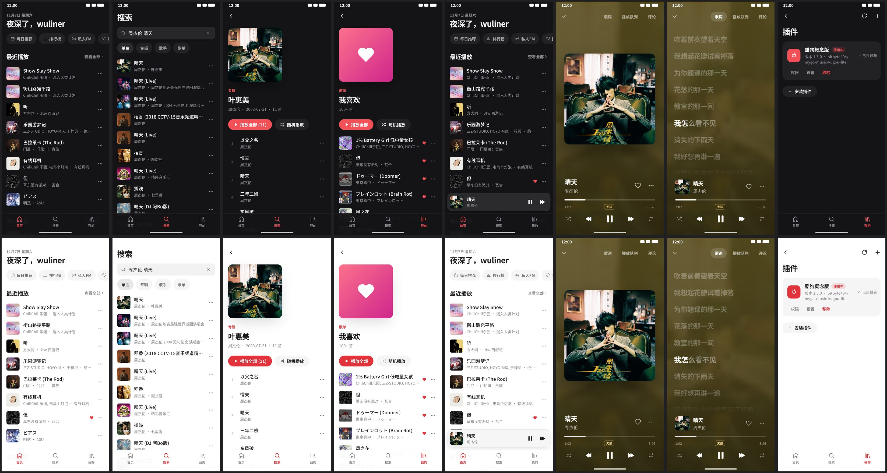

# MyGo 音乐 (mygo_mobile)

[English](README.md) | 简体中文



一款移动端（Flutter）音乐播放器，可**原样运行 MyGo Music 插件**——与桌面应用 [egoist/mygo-music](https://github.com/egoist/mygo-music)
加载的 `plugin.json` + `index.js` 插件包完全相同。应用本身不提供任何音乐服务：所有曲库、登录、音频流和歌词
都来自已安装的插件（例如 [kugou-lite](https://github.com/bitbyte404/mygo-music-kugou-lite)）。

优先支持 Android（包名 `io.github.bitbyte404.mygo_mobile`）；代码为纯 Flutter + dart:ffi，因此
后续可跟进 iOS。

## 功能

- **外观与动效与 MyGo Music 一致**，并针对触屏做了适配：MyGo 的配色（浅色与深色，跟随
  系统）、字号层级、图标、封面、歌曲行、胶囊标签、播放栏、Now Playing 以弹簧动画从播放栏
  展开并以封面配色作背景，以及会平滑滚动到当前演唱行的同步歌词。不使用 Material 默认外观。参见 [docs/DESIGN.md](docs/DESIGN.md)。
- **按宽度分级的自适应布局**：手机使用底部标签栏（首页 / 搜索 / 我的）和迷你播放器，可
  展开为 Now Playing（点击或上拉；下拉 Now Playing 关闭）；平板、折叠屏
  和横屏（≥ 840 dp）使用桌面布局：插件导航位于侧边栏，卡片
  网格、播放栏，以及封面与歌词并排的 Now Playing；600–840 dp 使用图标导航栏（icon rail）。
- **Edge to edge（全面屏沉浸）**：内容和封面绘制在透明的状态栏和导航栏之下（无
  对比度遮罩，短边适配刘海/挖孔）；系统栏图标颜色跟随主题和 Now Playing 的
  封面；标签栏和迷你播放器位于手势条或三键导航栏之上。
- **插件运行时**——每个插件在各自的 QuickJS-ng 引擎（`libmygojs.so`）中运行，各占一个
  后台 isolate，桌面端的宿主 API 用 Dart 重新实现：存储、设置、
  多语言（`host.t`）、md5 / AES / RSA、仅限插件声明的网络权限范围内的 `fetch`、
  定时器，以及登录提示（二维码 / 链接）。
- **安装插件**：可从 GitHub 仓库安装（通过 codeload 下载默认分支 zip；`plugin.json` 位于
  根目录或下一级目录），也可从本地 zip 安装，安装前会进行权限审查。
  更新检查从 raw.githubusercontent.com 读取仓库的 `plugin.json`（不受 GitHub API 速率限制）。
  深层链接 `mygo-music://install-plugin?repo=owner/repo`（与桌面应用响应的一致）会打开安装界面，
  冷启动时打开也会在应用就绪后继续安装。各入口走同一个安装流程，失败时会提示具体原因
  （例如插件要求更新的应用版本、权限声明无效、网络错误），成功也会提示。
- **插件 API 与桌面版 0.1.25 对齐**：要求 `minAppVersion` 不高于 0.1.25 的插件都能安装。
  封面支持 `{size}` 尺寸占位，插件可为封面和音频请求附带请求头（跳转到其他主机时不再带上）。
- **插件设置**：按 `plugin.json` 中的类型显示文本框、密码框（遮挡输入）、开关和下拉选择；
  开关和下拉选择即改即存，文本和密码点「保存」后写入。
- **浏览**——插件的首页（问候语下方）、页面、专辑、歌手、歌单、“查看全部”页面、电台。
  页面在会话期间会被保留：返回某个标签页或页面时立即显示，并在内容过期时于后台
  静默刷新，同时保持滚动位置（参见 docs/DESIGN.md 的 Loading 一节）。
- **搜索**——歌曲 / 专辑 / 歌手 / 歌单，支持分页和搜索建议。
- **我的**——账号与扫码登录、喜欢的歌曲（“播放全部”会先加载
  剩余分页，再播放所有喜欢的歌曲）、最近播放（音源的列表与本设备的记录合并为一项）、
  歌单、收藏的专辑、插件自带的页面、插件、设置。
- **Now playing（正在播放）**——播放队列、音质选择（标准 … 无损/Hi-Res，视插件支持而定，
  带“无损”标识）、同步歌词（逐行与逐字时间轴，点击某行即可跳转）、插件导出评论时
  可查看评论。
- **播放**——just_audio + audio_service：后台播放、通知栏和锁屏
  控制、媒体按键。每首歌开始播放时才向插件请求音频流 URL
  （它们会过期），并附带插件返回的请求头。
- 界面支持简体中文和英文（两者都使用 Flutter 自带的本地化）。

## 架构

分层为 `core` → `data` → `features`，设计系统位于 `ui`，组合根位于
`app`；插件运行在 `PluginRuntime` 平台接口之后（目前是基于 FFI 的 QuickJS-ng，也可接入
Web 运行时）。详细说明、运行时/isolate 模型、架构图，以及插件如何映射到
各项功能：[docs/ARCHITECTURE.md](docs/ARCHITECTURE.md)。

```
lib/
  main.dart · app/ (bootstrap, services, app)
  core/      models, errors, plugin manifest, runtime interface + quickjs/ (JsEngine, PluginHost, PluginWorker)
  data/      plugins (manager, installer), library (MusicRepository, LikedStore), player, settings, navigation
  ui/        design system: theme (tokens, icons), components, layout
  features/  shell, home, browse, search, album, artist, playlist, liked, recent, stations, library,
             now_playing, lyrics, account, plugins, settings, common
  l10n/      the app's strings (zh-CN, en)
assets/js/prelude.js    JS side of the host API given to every plugin
native/                 QuickJS-ng amalgamation + mygojs.c bridge; build.sh
android/app/src/main/jniLibs/<abi>/libmygojs.so   prebuilt by native/build.sh android
```

插件的返回数据沿用桌面应用的 JSON 结构（`internal/music/music.go`）；时间单位为毫秒。

## 网页版

同一个应用也可以在浏览器中运行，由一个小型 Go relay（负责插件流量、音频流、
封面图、GitHub 安装）提供服务，并以访问令牌保护：只需一个容器。

```bash
echo "RELAY_TOKEN=$(openssl rand -hex 24)" > .env && mkdir -p data && sudo chown 65532:65532 data
docker compose up -d --build        # http://127.0.0.1:18090，前面加一层 TLS
```

插件在浏览器的 Web Worker 中运行；其数据保存在 IndexedDB 中。架构、安全
模型、环境变量和部署：[docs/WEB.md](docs/WEB.md)。截图：`screenshots/web.jpg`。

## 构建

普通机器（安装了 Flutter + Android SDK + NDK r28 的 x86_64 Linux/macOS）：

```bash
native/build.sh android          # 仅当 native/*.c 有改动时需要；预编译的 .so 文件已提交到仓库
flutter pub get
flutter build apk --release --split-per-abi
```

### 发布签名

`android/app/build.gradle.kts` 会读取 `android/key.properties`：

```
storePassword=...
keyPassword=...
keyAlias=mygo
storeFile=../keystore/release.jks
```

可用如下命令生成密钥：
`keytool -genkeypair -keystore android/keystore/release.jks -alias mygo -keyalg RSA -keysize 4096 -validity 10000`。
`android/key.properties` 和 `android/keystore/` 均已加入 gitignore。没有 `key.properties` 时，
release 构建会回退到 debug 密钥。**请备份 keystore**——对已安装
APK 的更新必须使用同一个密钥签名。

## 发布

推送标签 `v<版本号>`（须与 `pubspec.yaml` 的 `version:` 一致）会运行
[`.github/workflows/release.yml`](.github/workflows/release.yml)：构建已签名的分架构 APK
（arm64-v8a、armeabi-v7a、x86_64）和 `linux/amd64` + `linux/arm64` 镜像
`ghcr.io/bitbyte404/mygo-mobile:<版本号>`（同时打 `latest`），再创建 GitHub Release 并附上 APK
和 `SHA256SUMS.txt`。签名密钥来自仓库 Secrets：
`ANDROID_KEYSTORE_BASE64`、`ANDROID_STORE_PASSWORD`、`ANDROID_KEY_ALIAS`、`ANDROID_KEY_PASSWORD`。

## 测试

```bash
flutter test test/unit                      # 无需网络：controllers、navigation、lyrics、design tokens
native/build.sh host
MYGOJS_LIB=native/build/host/libmygojs.so flutter test test/kugou_live_test.dart
MYGOJS_LIB=native/build/host/libmygojs.so flutter test test/stack_stress_test.dart   # 4 个插件 isolate，480 次调用
```

在代理环境下，用 `MYGO_HTTP_PROXY=host:port` 为插件流量指定一个无需认证的代理，并用 `NO_PROXY=127.0.0.1,localhost` 让测试运行器自身的
localhost WebSocket 不走代理。

live 测试需要网络、一份 kugou-lite 的检出（`--dart-define=KUGOU_DIR=...`），以及位于
`test/fixtures/kugou-data/kugou-lite/storage.json` 的已登录 fixture（已加入 gitignore——其中包含登录信息）。它会检查
导出项、账号、首页、最近播放、搜索（所有类型）、喜欢、首字节为
`fLaC` 的无损音频流、标准音质音频流、歌词、评论，以及未导出的方法会以 `unsupported` 失败。
结果写入 `build/kugou_live_results.json`。

## 已知不足 / 尚未验证

仅在无界面环境下验证过（插件运行时 + kugou-lite 实时调用、手机/平板尺寸的界面、
release 构建与签名）。尚未在真机上验证：

- 实际音频播放（包括 ExoPlayer 对 FLAC / Hi-Res 的解码），
- 后台播放、通知栏和锁屏控制，
- 界面中的扫码登录流程，
- 通过文件选择器从 zip 安装插件，
- `mygo-music://install-plugin` 深层链接，
- 触控手感：迷你播放器拖动、下拉关闭、歌词滚动以及真实硬件上的帧率，
- 真机上的 edge-to-edge 效果（状态栏/导航栏颜色、三键导航、刘海/挖孔）以及
  Android 返回手势，
- iOS：完全没有构建（需要 Mac；`libmygojs` 需静态链接 / 以 xcframework 形式链接）。

其他不足：没有下载 / 离线缓存；不支持仅限桌面端的插件导出（例如 `remoteState`
返回 `unsupported`）。
