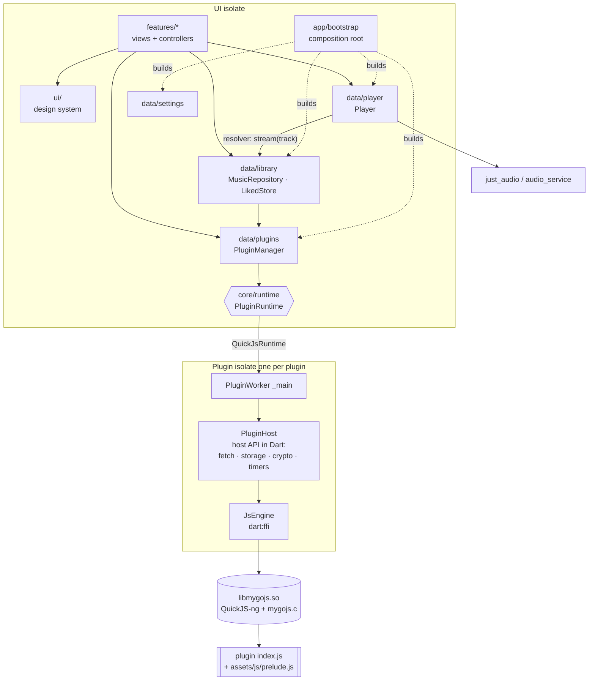

# Architecture

MyGo 音乐 is a Flutter app that runs **MyGo Music plugins** (`plugin.json` + one JS file) the same
way the desktop app does, and draws a MyGo-styled, adaptive UI around them. This document covers
the layers, how data flows, the plugin runtime and its isolate model, how plugins map to features,
and how to add a platform (web, iOS).

## Layers

```
lib/
  main.dart            entry: edge-to-edge, bootstrap(), runApp
  app/                 composition root
    bootstrap.dart       builds everything in dependency order (the only place that does)
    services.dart        Services: the long-lived objects; `svc` hands them to widgets
    app.dart             MyGoApp: theme (light/dark), locale + localization delegates, AppShell
  core/                platform-neutral foundations, no Flutter widgets
    errors.dart          PluginError {code: signIn|setup|unavailable|unsupported|'', message}
    models/              Track, Album, Artist, Playlist, Browse/Section, StreamInfo, LyricLine, ...
                         parsed from the desktop's JSON shapes (internal/music/music.go)
    plugin/manifest.dart plugin.json
    runtime/             the plugin runtime platform interface + implementations
      plugin_runtime.dart  PluginRuntime / PluginConnection / PluginSpec / WorkerEvent
      runtime_factory.dart picks the implementation at compile time (dart.library.ffi)
      quickjs/             QuickJS-ng over dart:ffi: JsEngine, PluginHost (host API), PluginWorker (isolate)
      web/                 placeholder runtime for builds without dart:ffi
  data/                state and repositories over core; no widgets
    plugins/             PluginManager (installed plugins, active one, events), Installer (GitHub/zip)
    library/             MusicRepository (typed plugin API), LikedStore (hearts, optimistic)
    player/              Player: just_audio + audio_service, queue, stream resolution, clock
    settings/            AppState: language, theme, quality, play history (JSON files)
    navigation.dart      plugin navigation → sidebar/library entries (pure, unit-tested)
  l10n/strings.dart    the app's own strings, zh-CN and en (plugins translate theirs via host.t)
  ui/                  the design system; knows nothing of plugins or playback
    theme/               tokens (colors, type, radii, sizes, motion, width classes), ThemeData, icons
    components/          Pressable, buttons, CoverArt + ArtTint, Scrubber, segmented, chips, sheets, toasts...
    layout/page.dart     MgPage (top scroll edge), page insets per width class
  features/            screens, each with its view and, where it holds state, a controller
    shell/               AppShell (adaptive frame), destinations, navigation (content navigator)
    home/ browse/ search/ album/ artist/ playlist/ liked/ recent/ stations/ library/
    now_playing/ lyrics/ account/ plugins/ settings/ common/ (shared lists, cards, loader)
native/                QuickJS-ng amalgamation + mygojs.c bridge; build.sh (host, Android ABIs)
android/               the Android host (edge-to-edge activity, audio_service, jniLibs)
```

Dependency rule (checked with grep in CI-less builds, see the end): `ui` and `core` import
nothing above them; `data` imports only `core`/`l10n`; `features` use `data` through
`MusicRepository`/`LikedStore`/`Player`/`PluginManager` and never touch `core/runtime`; only
`app/` knows concrete implementations.



## State management and DI

- One consistent pattern, the one the app already used: `ChangeNotifier` / `ValueNotifier` for
  state, `ListenableBuilder` / `ValueListenableBuilder` in widgets. No extra framework.
- Controllers own feature state that outlives a frame and is worth testing without widgets:
  `SearchController` (query, kind, paging, suggestion debounce and cancellation),
  `LikedController` (paging, "play all" loading every page), `NowPlayingController` (open/pane/
  progress), `LyricsCache` + `lyricIndex`, `ShellState` (destination). Simple read-only pages use
  `Loader<T>` (a FutureBuilder with refresh and typed error remedies) over one repository call.
- Dependency injection: the data layer takes its collaborators through constructors
  (`PluginManager(runtime: …)`, `MusicRepository(pluginManager)`, `LikedStore(repository)`,
  controllers take functions), so tests pass fakes. The composition root (`app/bootstrap.dart`)
  builds the graph once and publishes it as `svc`, a service locator read only by widgets; tests
  build their own `Services` (see `test/screenshots_test.dart`).
- Errors are typed: everything a plugin call can throw is a `PluginError` with the desktop's codes;
  `Services.describe` turns it into the listener's language and `ErrorView` offers the remedy
  (sign in, open the plugin's settings, retry).

## Plugin runtime and the isolate boundary

- `PluginRuntime.start(PluginSpec)` → `PluginConnection` (`call`, `exports`, `settings`, `events`,
  `setSetting`, `setLanguage`, `close`). This is the platform interface.
- `QuickJsRuntime` spawns one **background isolate per plugin** (`PluginWorker`). Only plain
  messages cross: `{op: call, method, params, timeout}` in, `{type: result, ok, value | code,
  message}` and `{type: event, event, data}` out. The UI isolate never blocks on JS (signing,
  RSA, inflating lyrics happen in the plugin's isolate).
- Inside the isolate, `PluginHost` implements the desktop host API (`internal/plugin/host.go`) in
  Dart: storage, settings, locales (`host.t`), md5/AES/RSA, `fetch` limited to the manifest's
  network permission, timers, sign-in prompts (QR / link) and `openURL`, reported as events.
- `JsEngine` calls `libmygojs` (QuickJS-ng + `native/mygojs.c`) through `dart:ffi`. A Dart isolate
  is not bound to an OS thread: between calls it may resume on another thread of the VM's pool, so
  every `mg_*` entry point re-reads the stack top (`JS_UpdateStackTop`) on the thread it runs on;
  a nested entry (a host callback re-entering) keeps the outer one. Without this, QuickJS checked
  the stack against the thread the runtime was created on and calls failed with "Maximum call
  stack size exceeded" (reproduced by `test/stack_stress_test.dart`: 241–439 of 480 calls failed
  per run with the old library, 0 of 480 in 5 runs with the fix). The JS stack budget is 1 MiB.

## How plugins map to features

| plugin export (desktop API) | repository method | feature |
|---|---|---|
| `home`, `browse({page})` | `home`, `browse` | home (greeting + sections), browse pages, "See all" |
| `navigation` (plugin.json) | `buildNavEntries` | sidebar (expanded), rail (medium), library + Home chips (compact) |
| `search`, `suggest` | `search`, `suggest` | search (kinds as chips, paging, suggestions) |
| `album`, `artist`, `playlist`, `playlists`, `savedAlbums` | same names | album, artist, playlist screens, library |
| `liked({offset})`, `isLiked`, `like` / `likeEpisode` | `liked`, `isLiked`, `like` | liked (paged; Play all loads every page), hearts everywhere |
| `recent` or a navigation page titled "recently played" | `recent` / `browse` | recent: one entry, source list + this device's history |
| `stations`, `stationNext` | `stations`, `stationNext` | stations; the player refills radio queues |
| `stream({id, quality})`, `played` | `stream`, `played` | player (stream URL + headers resolved as each track starts) |
| `lyrics`, `comments` | `lyrics`, `comments` | Now Playing: lyrics pane (synced, word timing), comments pane |
| `account`, `signIn`, `signOut` | same names | library account row, QR sign-in dialog |

What a plugin does not export is not offered (`MusicRepository.can`).

## Adding a platform

**iOS.** Everything above `core/runtime/quickjs` is platform-neutral. Build `libmygojs` for iOS
as a static library / xcframework from `native/quickjs-amalgam.c` + `native/mygojs.c` and link it
into the Runner (`JsEngine` already resolves the symbols with `DynamicLibrary.process()` on iOS and
macOS; make sure the `mg_*` symbols are not dead-stripped). audio_service / just_audio need the iOS background-audio capability in
`Info.plist`. Edge-to-edge needs nothing extra (iOS draws under the bars; the app already pads by
`viewPadding`).

**Web.** There is no `dart:ffi`, so `runtime_factory.dart` picks `UnsupportedRuntime` (plugins fail
to start with a clear error). A web runtime would implement `PluginRuntime` by running the plugin
in a Web Worker with the host API written in JS (the counterpart of `prelude.js` + `PluginHost`),
storage in IndexedDB, and `fetch` relayed through a small proxy (plugins' APIs rarely send CORS
headers; the manifest's network permission still applies at the relay). Two IO-bound pieces would
need web variants too: `PluginManager`/`Installer` (plugin folders on disk) and `AppState`
(settings files), e.g. behind a small storage interface. The UI, design system, repositories and
player model need no change.

**Desktop (Linux/macOS/Windows).** `QuickJsRuntime` works wherever `libmygojs` can be built
(`native/build.sh host` already builds it for the Linux test runs).

## Tests

- `test/unit/` (no network): navigation merging, lyrics index / word timing / LRC parsing / cache,
  `SearchController` (a search cancels a pending or in-flight suggestion), `LikedController`
  (play all loads every page, concurrent loads share a request), artwork tint, backdrop colors,
  width classes, icon parsing.
- `test/kugou_live_test.dart`: the real kugou-lite plugin through `PluginHost` (network + fixture).
- `test/stack_stress_test.dart`: four plugin isolates, 480 calls with idle gaps (the stack-top bug).
- `test/screenshots_test.dart`: the real app at phone and tablet sizes with live data.

Layering check used before committing:
`grep -rn "package:mygo_mobile/\(app\|data\|features\)" lib/ui lib/core` and
`grep -rn "core/runtime" lib/features` must both print nothing.
